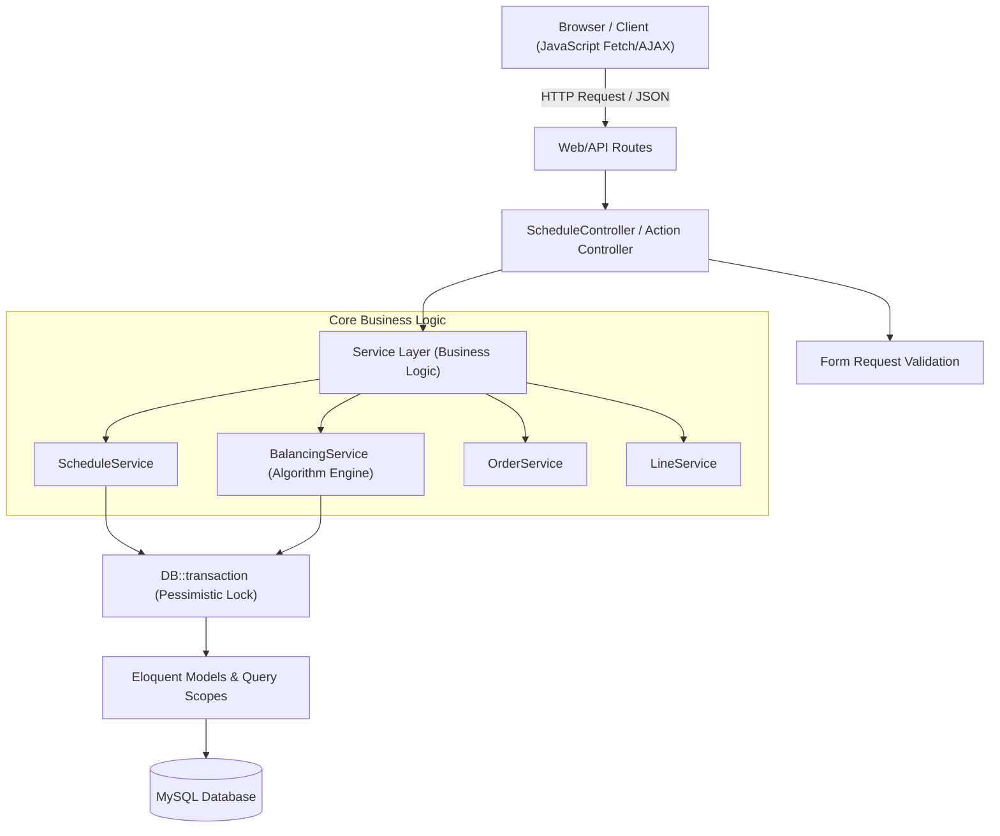
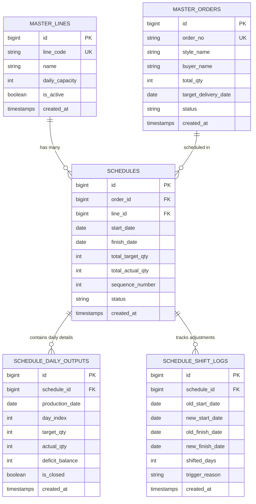

# ARSITEKTUR SISTEM: SEWING LINE PRODUCTION SCHEDULER & AUTO-BALANCING

Dokumen ini mendefinisikan arsitektur teknis, domain data, algoritma bisnis, dan standar implementasi untuk aplikasi Web Penjadwalan Produksi Sewing Line (Garment Manufacturing) berbasis Laravel & MySQL.

---

## 1. Domain Overview & Problem Statement

### 1.1 Latar Belakang
Pada industri manufaktur garmen (sewing), setiap sewing line memiliki kapasitas dan alokasi pesanan (*order schedule*). Kendala utama di lantai produksi adalah deviasi antara **target output harian** dan **aktual output harian** (akibat kendala mesin, absensi operator, keterlambatan material/cutting, dll.).

### 1.2 Masalah yang Diselesaikan
1. **Distribusi Target Harian yang Presisi**: Membagi total kuantitas order ke dalam rentang tanggal kerja secara merata, dengan alokasi sisa pecahan (*remainder*) pada hari terakhir schedule.
2. **Dynamic Balancing & Cascade Rescheduling**: Apabila output aktual harian tidak memenuhi target, selisih defisit harus di-carry over ke hari berikutnya dan/atau menambah durasi jadwal (bertambah hari). Penambahan hari ini memicu efek domino (*cascade shift*) yang memundurkan jadwal order-order berikutnya pada line yang sama secara otomatis tanpa merusak integritas urutan kerja.
3. **Reactivity & Modern UX**: Admin membutuhkan interaksi cepat melalui antarmuka berbasis JavaScript (tanpa reload halaman) dengan indikator status pemrosesan yang jelas (loading state, feedback berhasil/gagal, dan recalculation preview).

---

## 2. Arsitektur Aplikasi (Layered Service Pattern)

Mengikuti arsitektur *Clean Layered Architecture* di Laravel:



### 2.1 Peran Tiap Layer
| Layer | Tanggung Jawab | File Terkait |
| :--- | :--- | :--- |
| **Presentation (UI/JS)** | Antarmuka interaktif, modal input aktual, feedback visual, pemanggilan async API. | `resources/views/schedules/*`, `resources/js/schedule.js` |
| **HTTP / Controller** | Menerima request, memanggil validator, meneruskan ke Service, mengembalikan response JSON / Blade view. Ramping (*skinny controller*). | `app/Http/Controllers/*` |
| **Validation** | Memastikan format tanggal, kuantitas positif, dan validitas referensi data. | `app/Http/Requests/*` |
| **Service Layer** | Jantung logika bisnis: kalkulasi pembagian target, komputasi balancing, pergeseran cascade schedule, dan audit logging. | `app/Services/*` |
| **Model / ORM** | Definisi entitas, relasi, cast attributes, dan local query scopes. | `app/Models/*` |
| **Database** | Penyimpanan data relasional dengan indeks performa tinggi dan integritas referensial. | MySQL Engine InnoDB |

---

## 3. Desain Basis Data (Schema & Relasi)

### 3.1 Entity Relationship Diagram (ERD)



### 3.2 Spesifikasi Kolom Tabel

#### A. Tabel `master_lines`
Menyimpan referensi line sewing produksi garmen.
- `id` (BIGINT, PK, AUTO_INCREMENT)
- `line_code` (VARCHAR(50), UNIQUE) — Contoh: `LINE-01`, `LINE-02`
- `name` (VARCHAR(100)) — Contoh: `Sewing Line A (Kemeja)`
- `daily_capacity` (INT, DEFAULT 1000) — Kapasitas ideal per hari
- `is_active` (BOOLEAN, DEFAULT true)
- `created_at`, `updated_at`

#### B. Tabel `master_orders`
Menyimpan data pesanan garment yang siap dijadwalkan.
- `id` (BIGINT, PK, AUTO_INCREMENT)
- `order_no` (VARCHAR(100), UNIQUE) — Contoh: `PO-2026-001`
- `style_name` (VARCHAR(100)) — Contoh: `Basic Polo Shirt Navy`
- `buyer_name` (VARCHAR(100)) — Contoh: `Uniqlo / H&M`
- `total_qty` (INT) — Total order target
- `target_delivery_date` (DATE) — Batas waktu kirim
- `status` (ENUM: `pending`, `scheduled`, `in_progress`, `completed`, `cancelled`)
- `created_at`, `updated_at`

#### C. Tabel `schedules`
Header jadwal produksi per line per order.
- `id` (BIGINT, PK, AUTO_INCREMENT)
- `order_id` (BIGINT, FK -> `master_orders.id`, INDEX)
- `line_id` (BIGINT, FK -> `master_lines.id`, INDEX)
- `start_date` (DATE) — Tanggal mulai produksi di line
- `finish_date` (DATE) — Tanggal estimasi selesai (dinamis, dapat bergeser)
- `total_target_qty` (INT) — Target kuantitas yang dialokasikan
- `total_actual_qty` (INT, DEFAULT 0) — Akumulasi aktual yang sudah diinput
- `sequence_number` (INT, DEFAULT 1) — Nomor urut eksekusi antrian pada line bersangkutan
- `status` (ENUM: `draft`, `confirmed`, `running`, `completed`, `delayed`)
- `created_at`, `updated_at`

#### D. Tabel `schedule_daily_outputs`
Detail pembagian target dan rekaman aktual harian per tanggal.
- `id` (BIGINT, PK, AUTO_INCREMENT)
- `schedule_id` (BIGINT, FK -> `schedules.id`, ON DELETE CASCADE, INDEX)
- `production_date` (DATE, INDEX)
- `day_index` (INT) — Hari ke-1, ke-2, dst.
- `target_qty` (INT) — Target yang harus dicapai pada tanggal tersebut
- `actual_qty` (INT, NULLABLE) — Realisasi yang diinput oleh admin
- `deficit_balance` (INT, DEFAULT 0) — Selisih `target_qty - actual_qty` (jika actual < target)
- `is_closed` (BOOLEAN, DEFAULT false) — Ditandai true jika admin telah mengunci input hari tersebut
- `created_at`, `updated_at`
- *Unique Constraint*: `(schedule_id, production_date)`

#### E. Tabel `schedule_shift_logs` (Audit Trail)
Mencatat riwayat perubahan tanggal akibat penambahan hari dan efek domino cascade.
- `id` (BIGINT, PK, AUTO_INCREMENT)
- `schedule_id` (BIGINT, FK -> `schedules.id`, INDEX)
- `old_start_date` (DATE)
- `new_start_date` (DATE)
- `old_finish_date` (DATE)
- `new_finish_date` (DATE)
- `shifted_days` (INT) — Jumlah hari kemunduran
- `trigger_reason` (VARCHAR(255)) — Penyebab (misal: "Actual output deficit on 2026-03-01 by 150 pcs")
- `created_at` (TIMESTAMP)

---

## 4. Algoritma Inti (Business Logic & Calculation Engine)

### 4.1 Algoritma Distribusi Target Harian (Initial Scheduling)
Sesuai Ketentuan Poin 2:
$$\text{Jumlah Hari } N = (\text{finish\_date} - \text{start\_date}) + 1$$
$$\text{Base Target Per Hari} = \lfloor \frac{\text{Total Qty Target}}{N} \rfloor$$
$$\text{Sisa Pecahan (Remainder)} = \text{Total Qty Target} \pmod N$$

**Alokasi Distribusi:**
- Hari ke-1 s/d Hari ke-$(N-1)$: $\text{Target} = \text{Base Target Per Hari}$
- Hari ke-$N$ (hari terakhir): $\text{Target} = \text{Base Target Per Hari} + \text{Remainder}$

*Contoh Kasus:*
- Total Target: 1.000 pcs
- Rentang: 3 Hari (1 Maret - 3 Maret)
- $N = 3$ hari
- Base target: $\lfloor 1000 / 3 \rfloor = 333$ pcs
- Remainder: $1000 \pmod 3 = 1$ pcs
- Hari 1 (1 Maret): 333 pcs
- Hari 2 (2 Maret): 333 pcs
- Hari 3 (3 Maret): $333 + 1 = 334$ pcs. Total = 1.000 pcs (100% akurat).

---

### 4.2 Algoritma Input Aktual, Balancing, & Dynamic Extension
Sesuai Ketentuan Poin 3:
Ketika admin menginput nilai `actual_output` pada tanggal tertentu ($T$):
1. **Cek Deviasi**:
   $$\text{Defisit } \Delta = \text{target\_qty}_T - \text{actual\_qty}_T$$
2. **Kondisi 1: Output Sesuai / Lebih ($\Delta \le 0$)**:
   - Jadwal berjalan normal atau surplus disimpan sebagai buffer. Tidak ada penambahan hari schedule.
3. **Kondisi 2: Output Kurang / Defisit ($\Delta > 0$)**:
   - Defisit ditambahkan ke target hari berikutnya ($T+1$).
   - Jika penambahan defisit ke hari berikutnya melebihi kapasitas maksimum sewing line, atau jika jadwal telah berada di hari terakhir/membutuhkan perpanjangan durasi:
     - Range tanggal schedule diperpanjang $+K$ hari (di mana $K$ dihitung dari sisa total target yang belum terkejar).
     - Kolom `finish_date` pada tabel `schedules` bertambah $+K$ hari.
     - Baris baru diinsert ke tabel `schedule_daily_outputs` untuk tanggal-tanggal perpanjangan.

---

### 4.3 Algoritma Cascade Rescheduling (Efek Domino Pergeseran)
Ketika Schedule $S_A$ pada Line $L$ bertambah durasinya sebanyak $K$ hari:
$$\text{New Finish Date } S_A = \text{Old Finish Date } S_A + K \text{ hari}$$

Maka semua schedule berikutnya ($S_{B}, S_{C}, \dots$) pada Line $L$ yang memiliki `start_date` $\le \text{New Finish Date } S_A$:
1. Mengunci transaksi basis data menggunakan `lockForUpdate()`.
2. Menghitung tanggal mulai baru bagi $S_B$:
   $$\text{New Start Date } S_B = \text{New Finish Date } S_A + 1 \text{ hari}$$
3. Mempertahankan durasi kerja awal $S_B$:
   $$\text{Duration } S_B = (\text{Old Finish Date } S_B - \text{Old Start Date } S_B)$$
   $$\text{New Finish Date } S_B = \text{New Start Date } S_B + \text{Duration } S_B$$
4. Menggeser seluruh tanggal pada baris detail `schedule_daily_outputs` milik $S_B$ sebanyak selisih pergeseran.
5. Melakukan iterasi berantai (*cascade loop*) untuk schedule $S_C, S_D$ setelahnya sampai tidak ada lagi jadwal yang tumpang tindih (*overlap*).
6. Mencatat perubahan di `schedule_shift_logs`.

---

## 5. Alur Interaksi Frontend & JavaScript

Sesuai Ketentuan Poin 5:
- Semua aksi perubahan data (pembuatan schedule, submit actual output, kalkulasi balancing) dijalankan via JavaScript (Fetch API / Asynchronous).
- **Indikator Proses (Lifecycle UX)**:
  1. **Before Process**: Tombol input disabled, loading spinner / skeleton dimunculkan, toast "Memproses kalkulasi balancing...".
  2. **During Process**: Kirim data JSON ke endpoint Laravel via AJAX/Fetch, CSRF header diinjeksi.
  3. **After Process (Success)**: Notifikasi sukses, penutupan modal, pembaruan tabel/timeline secara DOM replacement atau re-render data JSON tanpa full-page refresh.
  4. **After Process (Error / Validation Failure)**: Mengembalikan tombol ke keadaan semula, menampilkan error alert spesifik (misal: "Actual output tidak boleh bernilai negatif").

---

## 6. Standar Keamanan & Transaksi Data

1. **Atomic DB Transactions**:
   Seluruh operasi pergeseran tanggal dan kalkulasi balancing wajib berada di dalam blok:
   ```php
   DB::transaction(function () use (...) {
       // Operasi balancing & cascade rescheduling
   });
   ```
2. **Pessimistic Locking**:
   Gunakan `Schedule::where('line_id', $lineId)->lockForUpdate()->get()` saat proses cascade shift untuk mencegah *race condition* jika dua admin menginput bersamaan pada line yang sama.
3. **Data Integrity**:
   - Foreign key constraint dengan `restrict` pada master data order dan line agar tidak terhapus jika sudah memiliki schedule aktif.
   - Soft deletes pada schedule jika diperlukan pembatalan.
